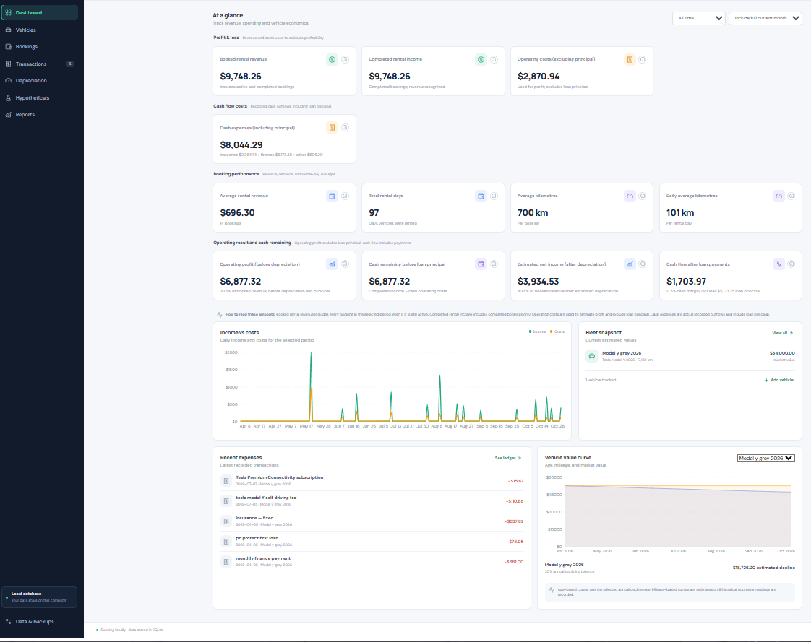

# Car Rental Ledger — Self-Hosted Vehicle Rental Management

Vehicle rentals, expenses, receipts, and profitability in one app. Self-hosted on a machine you own.

[Developers](#developers) · [Features](#features) · [Data and privacy](#data-and-privacy) · [License](#license)



Car Rental Ledger is a local-first rental fleet management app for vehicle owners and small rental operators. Record a booking, add the related expenses, and see revenue, cash flow, estimated profit, and depreciation in one place.

Everything runs on your own computer. Your vehicle records, rental history, and receipts stay in a local SQLite database instead of being sent to somebody else's cloud.

## ✨ Features

- **Vehicles:** track purchase values, odometers, market valuations, loans, insurance, and depreciation assumptions.
- **Bookings:** record direct and Turo rentals, dates, rates, included kilometres, extra mileage, deposits, and add-ons.
- **Expenses:** organize operating costs, finance payments, capital items, recurring monthly expenses, and vehicle-linked costs.
- **Receipts:** upload PDF, JPG, PNG, and WEBP receipts and link them to expenses.
- **Dashboard:** review revenue, operating costs, estimated profit, cash flow, depreciation, and booking performance.
- **Reports:** inspect vehicle economics, rental profitability, daily rates, expenses, and valuation history.
- **Backups:** export and restore records as JSON; export expenses as CSV.
- **Self-hosted:** run the frontend, API, and SQLite database locally with no account, cloud sync, or third-party API keys.

## 🚀 Getting started

### Requirements

- Node.js 20 or newer (Node 22 LTS recommended)
- npm

### Windows

Open PowerShell in the project directory and run:

```powershell
npm install
npm run dev
```

Or double-click `start.bat`.

### macOS and Linux

```bash
npm install
npm run dev
```

Then open the frontend at:

<http://127.0.0.1:5173>

The development server starts:

- Vite frontend on port `5173`
- Local Express API on port `8787`

The server binds to `127.0.0.1`, so it is not exposed to your local network by default.

### Production mode

```bash
npm run build
npm start
```

Open <http://127.0.0.1:8787>.

To use another API port, set `PORT`:

```bash
PORT=9000 npm start
```

## 🛠️ Developers

The main project areas are:

```text
src/              React frontend and calculation logic
server/           Express API and SQLite setup
docs/images/      README screenshots
data/             Local database and uploaded receipts
```

Useful commands:

```bash
npm run dev       # Start the frontend and API together
npm run build     # Type-check and build the production frontend
npm start         # Start the production API and bundled frontend
```

## 🔒 Data and privacy

Car Rental Ledger is designed to keep application data local:

- Database: `data/rental-ledger.sqlite`
- SQLite journal files: `data/rental-ledger.sqlite-shm` and `data/rental-ledger.sqlite-wal`
- Uploaded receipts: `data/receipts/`

These paths are excluded from Git. Keep the database and receipt directory together when making backups. The **Data & backups** screen exports JSON records, but receipt files must be copied separately.

There is no login, encryption, cloud sync, or access control layer. Protect the computer and backups where the application is installed. Do not expose the API to the public internet without adding authentication and a properly configured reverse proxy.

## 📊 Calculation notes

- Rental revenue uses Turo gross trip income when provided; otherwise it uses daily rental income plus applicable mileage and additional income.
- Rental distance is the end odometer minus the start odometer, floored at zero.
- Mileage depreciation is estimated from rental kilometres and the vehicle's depreciation-per-kilometre assumption.
- Declining-balance depreciation uses the annual decline rate, purchase date, purchase price, and residual value.
- Estimated profit excludes loan principal and subtracts estimated depreciation. Cash flow includes all recorded cash expenses, including loan principal.
- Recurring monthly expenses are included in later monthly calculations.
- Commercial insurance replaces the personal daily insurance share on rental days; it is not added on top.
- Turo fees, taxes, discounts, and charging reimbursements are retained as reference fields and are not automatically treated as operating costs.
- Results are management estimates, not tax advice or formal accounting statements.

## 🤝 Contributing

Issues, bug reports, documentation improvements, and pull requests are welcome. Before opening a pull request:

1. Keep personal databases, receipts, backups, and `.env` files out of commits.
2. Run `npm run build`.
3. Describe the user-facing change and any calculation changes clearly.

## ❤️ Support the project

If this project helped you, saved you time, or inspired you, consider supporting its future growth and maintenance. You can show your support by starring the repository, sharing the project, or via GitHub Sponsors, PayPal, Liberapay, or Buy Me a Coffee.

Open-source software requires time, effort, and resources to maintain. Your support helps keep this project alive, up-to-date, and accessible to everyone. Every contribution, big or small, makes a difference and motivates continued work on features, bug fixes, and new ideas.

## 📄 License

Car Rental Ledger is open source under the [MIT License](LICENSE). You may use, modify, and redistribute it, including in commercial projects, provided that the license and copyright notice are preserved.
